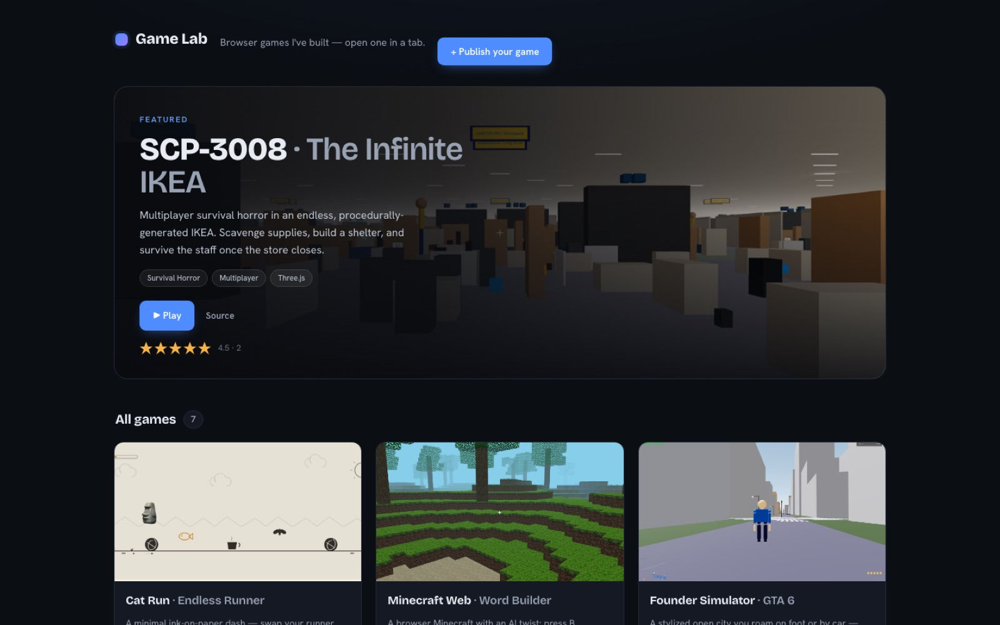

# Game Lab (arcade-hub)

Game Lab (arcade-hub) is a game hub website that links to free browser games you can play in a tab with no download, built with React and Vite for players looking for web games.



Live demo: https://www.onlygame.site (also at https://arcade-hub-gilt.vercel.app)

## Features

- One landing page for every game in the `Games/` workspace: a featured game plus an "All games" grid, each card with a gameplay screenshot, a one-line intro, tags, a **Play** link and a **Source** link.
- Cards show as **Live** when a deployed URL is set, or **Local / Not deployed** when it is empty.
- Star ratings (1-5) for each game; one vote per browser, last vote wins.
- **Publish your game**: visitors submit a link to their own browser game. A serverless function fetches the page, extracts its title, icon and preview image, asks an LLM for a short description, tags and a safety verdict, and queues it for review. Approved games appear in a Community section.
- An admin endpoint (gated by `ADMIN_KEY`) lists, approves and rejects submissions.
- SEO basics: static metadata, canonical URL, Open Graph / Twitter cards, JSON-LD, `robots.txt`, `sitemap.xml` and a site-level `public/llms.txt`.

Games currently listed include SCP-3008: The Infinite IKEA, Cat Run, Minecraft Web: Word Builder, Founder Simulator (GTA 6 and WebGPU versions), The Backrooms Online and F-22 Lightning II (1996, DOS, via js-dos).

## How it works / Tech stack

- **Frontend:** React 18 + Vite 5 single-page app (`src/`). Vercel auto-detects Vite and builds it to `dist/`.
- **API:** Vercel serverless functions in `api/`:
  - `data.js` - public read of approved community games and rating averages (degrades gracefully if the store is down)
  - `rate.js` - record a 1-5 star vote
  - `submit.js` - the submission "agent" (fetch page, extract metadata, LLM description + tags + safety check, queue for review)
  - `admin.js` - review queue: list / approve / reject
  - `_store.js` - a GitHub-backed JSON datastore (`community.json` in a separate data repo, so writes never trigger a hub redeploy)
- **Configuration (environment variables, never committed):** `GH_TOKEN`, `GH_DATA_REPO`, `LLM_BASE_URL`, `LLM_TOKEN`, `LLM_MODEL`, `ADMIN_KEY`.

## Getting started

### Develop / build

```bash
npm install
npm run dev       # http://localhost:5173
npm run build     # outputs dist/
npm run preview   # serve the production build
```

### Adding / updating links

Open `src/games.js` and edit the `GAMES` array:

```js
{
  title: "F-22 Lightning II",
  ...
  path: "f22-lightning-web",          // folder under Games/
  url: "https://your-game.vercel.app" // ← paste the deployed URL here
}
```

- `url: ""` → the card shows as **Local / Not deployed**.
- A non-empty `url` → the card flips to **Live** and the Play button links to it.

### Deploy the hub

```bash
cd hub
vercel --prod
```

### Deploy the individual games

Each game is its own project with its own `vercel.json`:

```bash
cd ../f22-lightning-web && vercel --prod
cd ../gta6             && vercel --prod
cd ../gtav-web         && vercel --prod
cd ../backroom         && vercel --prod   # full-stack (client + server)
cd ../SCP3008          && vercel --prod   # full-stack (client + server)
```

Then copy each deployment URL back into `hub/src/games.js` → `GAMES[].url`.

## Project structure

```
api/            Vercel serverless functions (data, rate, submit, admin, _store)
public/         favicon, OG image, game screenshots (shots/), robots.txt, sitemap.xml, llms.txt
src/App.jsx     the hub UI (featured game, game grid, ratings, publish form)
src/games.js    the GAMES list (title, intro, tags, screenshot, url)
src/styles.css  styles
index.html      page shell with SEO metadata
vercel.json     headers config
```

## License

No license file is included in this repository.
